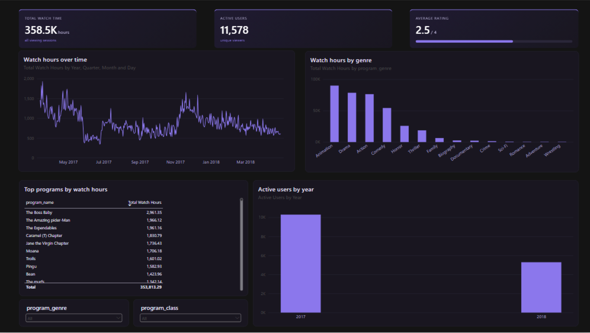

# STC TV Viewership Dashboard

An interactive Power BI dashboard built on approximately 1 million TV viewing sessions. Raw data was cleaned and transformed in Python (`pandas`), modeled in Power BI using DAX, and styled with a custom dark theme and HTML KPI cards.



---

## Metric Highlights

| Metric | Value |
| :--- | :--- |
| **Total Watch Time** | 358.5K hours |
| **Unique Viewers** | 11,578 |
| **Viewing Sessions** | 1,048,575 |
| **Programs / Genres** | 8,013 / 16 |
| **Period Covered** | 14 Mar 2017 – 30 Apr 2018 |
| **Average Rating** | 2.5 / 4.0 |

---

## Key Business Insights

* **Genre Concentration:** Four primary genres (*Animation, Drama, Action, Comedy*) account for **~83%** of total watch hours.
* **Viewer Behavior:** **50.1%** of sessions are under 2 minutes, with a median session length of ~2 minutes, indicating high channel-browsing behavior rather than long-form consumption.
* **Rating Distribution:** Ratings are evenly distributed across values 1 to 4 (~25% each), making the 2.5 overall average neutral across genres.

---

## Data Source Overview

> *Note: Raw source files from the STC x Misk Data Analytics Workshop are excluded from this repository via `.gitignore`.*

| File | Description | Rows | Columns |
| :--- | :--- | :---: | :---: |
| `stc_raw_events.xlsb` | Event log containing session duration, user ID, program, genre, class, HD flag, and date | 1,048,575 | 13 |
| `stc_raw_ratings.xlsx` | Rating logs per user session | 1,048,575 | 2 |
| `stc_raw_daily_watchtime.xlsx` | Daily aggregated watch hours (86 days between Jan–Apr 2018) | 86 | 2 |

---

## Data Cleaning & Transformation (Python)

All preprocessing scripts reside in the `scripts/` directory:

1. **Date & Unit Normalization:** Converted Excel serial dates to standard ISO dates and added `duration_hours`.
2. **Missing & Flagged Values:** Replaced placeholder `0`s in season/episode fields for movies with `NULL`. Converted binary flags (`hd`, `series_title`) to booleans. Trimmed whitespace across string columns.
3. **Outlier Handling:** Flagged sessions exceeding 24 hours with `long_session_flag` rather than deleting them (*663 sessions representing 33.3K hours / 9.3% of total time*).
4. **Data Joining:** Generated a synthetic `row_id` across `events` and `ratings` to enable a 1:1 join relationship.

---

## Data Model & DAX Measures

`events_clean` and `ratings_clean` join 1-to-1 on `row_id`. Key DAX measures include:

```dax
Total Watch Hours = 
SUM(events_clean[duration_hours])

Active Users = 
DISTINCTCOUNT(events_clean[user_id_maped])

Average Rating = 
AVERAGE(ratings_clean[rating])

Average Session Duration = 
AVERAGE(events_clean[duration_hours])

Flagged Long Sessions = 
COUNTROWS(FILTER(events_clean, events_clean[long_session_flag] = TRUE()))
```


Built by Sama Alshehri.
